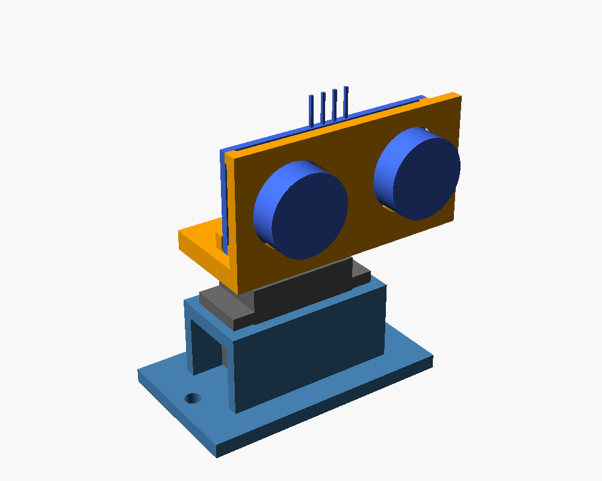

# James — Arduino radar

**Ninja:** James · **Coach:** Wim · **Started:** 2026-11-13

What James wants to build: <https://www.youtube.com/watch?v=kQRYIH2HwfY>, "Arduino Radar
Project" by How To Mechatronics (2015, 4m51s). The written tutorial, with schematic and code,
is at <https://howtomechatronics.com/projects/arduino-radar-project/> (fetched 2026-11-13).
The original code isn't copied here: `source/README.md` has the link. Below, under "What we
changed compared to the original", is every difference.

## How it works

A small servo turns an ultrasonic distance sensor back and forth from 15° to 165°. At every
degree the Arduino measures the distance and sends `angle,distance.` over USB to the laptop,
for example `45,23.`. A Processing sketch on the laptop reads that and draws a green radar
screen. Anything closer than 40 cm shows up red.

```
 HC-SR04 sensor ──┐                          USB             ┌──────────────────────┐
                  ├── Arduino (03_radar) ───────────────────▶│ Processing           │
 servo (turns it) ┘    sweeps, measures,     "45,23."        │ (radar_display)      │
                       sends angle,distance                  │ draws the radar      │
                                                             └──────────────────────┘
```

Two programs, on two devices, talking over one wire: that is the core of the project.

## Parts: what James has

James has three boxes (Wim, 2026-11-13): the **Arduino Starter Kit** (the classic one, with
the UNO R3), the **Keyestudio 37 in 1
sensor kit**, and a **set of 120 Dupont jumper wires** (40 female–male, 40 female–female, 40
male–male, 20 cm). Together they cover everything. **Nothing needs to be bought.**

| Needed | Comes from | Notes |
|---|---|---|
| Arduino UNO R3 + USB cable | Starter Kit | |
| Small servo motor, with horns and screws | Starter Kit | |
| 100 µF capacitor | Starter Kit (3 in the box) | For the servo's power, see Electronics |
| Breadboard | Starter Kit (400 holes) | Or the mini breadboard from the Keyestudio kit |
| Base | Starter Kit (wooden base) | The UNO and the breadboard go on it, and it becomes the radar's base |
| Ultrasonic sensor HC-SR04 | Keyestudio kit | In the box (Wim checked, 2026-11-13) |
| 4 jumper wires female–male | Dupont set | Sensor → breadboard / Arduino. No soldering needed |
| ~7 jumper wires male–male | Dupont set (or the Starter Kit's solid wires) | Servo plug → breadboard, breadboard → Arduino |
| Cardboard, hot glue or double-sided tape | — | For the sensor holder. The only thing not in a box |

Where this comes from:
- Starter Kit contents: the Arduino store page for the classic kit (web.archive.org snapshot
  of 2026-01-06). It has the UNO, the servo, 3× 100 µF, a 400-hole breadboard, the wooden
  base, a piezo, a 16×2 LCD and LEDs, but no ultrasonic sensor.
- Keyestudio: Amazon listing B07H7GRSD7, part number KS0349 (fetched 2026-11-13).
- Wires: Wim's photo of the listing.

James's laptop runs **Windows** (Wim, 2026-11-13). It needs the **Arduino IDE** and
**Processing 4** (both free: arduino.cc, processing.org).

## Electronics

Unplug USB while you wire.

| From | To |
|---|---|
| Arduino **5V** | breadboard **+** rail |
| Arduino **GND** | breadboard **−** rail |
| HC-SR04 **VCC** | + rail (female–male wire) |
| HC-SR04 **GND** | − rail |
| HC-SR04 **Trig** | Arduino pin **10** |
| HC-SR04 **Echo** | Arduino pin **11** |
| Servo **+** (red) | + rail (male–male wire into the servo plug) |
| Servo **−** (darkest wire: brown or black) | − rail |
| Servo **signal** (orange, yellow or white) | Arduino pin **12** |
| **100 µF capacitor** | across + and − rails, right next to the servo. **Long leg to +, the side with the stripe to −** |

Pins 10, 11 and 12 are the ones the article uses.

Before plugging USB in: check that no wire runs straight from + to −, and that the capacitor
is the right way round. A capacitor in backwards gets hot and can burst.

**Why the capacitor?** Everything runs on the laptop's USB. A servo pulls a burst of current
every time it starts moving. Without a buffer, the Arduino can reset, the servo jitters, or
the laptop complains about the USB device. The article doesn't mention it; the Starter Kit
includes the capacitors for exactly this reason.

## Mechanics

The Dojo has a 3D printer (Wim, 2026-11-13), so the holder is printed instead of cardboard.
There are two parts in `3d/`. They are our own design, not from the article.

- **Sensor head** (`radar_head.stl`): a faceplate with two holes for the "eyes", and a foot
  that goes on the servo horn. The sensor sits behind the faceplate **upside down**, pins at
  the top, so the wires go up and away from the servo. Upside down measures just the same.
- **Servo stand** (`radar_stand.stl`): the servo drops in from the top and hangs by its tabs.
  The ends are open for the cable.



**For Fusion or Onshape:** `radar_head.step` and `radar_stand.step` are the same parts as
real solids, with flat faces and round holes instead of the STL's triangles.

- **Fusion:** *File > Open > Open from my computer…*, pick the `.step`, and save. It is then a
  Fusion design. *File > Export* gives an `.f3d` file if you want one.
- **Onshape:** in a document, *Import…* (the **+** at the bottom left), pick the `.step`. It
  becomes a Part Studio.

A STEP file has no design history: the sizes aren't editable parameters. Small changes work
with Press Pull (Fusion) or Move face (Onshape). For new measurements it's easier to change
the `.scad` and export everything again.

### Before printing: measure

The STL files use **typical sizes, not James's parts**. Measure the parts (calipers if
there are some at the Dojo, otherwise a good ruler). If a value differs by more than about
0.5 mm, change it at the top of `3d/radar_parts.scad` and export again (OpenSCAD is free:
F6, then *File > Export > Export as STL*). The STEP files are made from the same numbers by
`3d/export_step.py`. Easiest: send me the numbers and I'll export both.

| What to measure | Typical | Name in the file |
|---|---|---|
| Diameter of one eye | 16 | `can_d` |
| Eye centre to eye centre | 26 | `can_spacing` |
| Board edge *without* pins → centre of an eye | 10 | `can_z` |
| Board width × height | 45 × 20 | `pcb_w`, `pcb_h` |
| Servo body length × width (without tabs) | 22.8 × 12.4 | `servo_l`, `servo_w` |
| Servo bottom → underside of the tabs | 15.8 | `tab_z` |
| Tab screw hole to tab screw hole | 27.8 | `tab_holes` |

The ones that matter most: the eye sizes (the eyes have to go through the holes) and the
servo body (it has to drop into the stand).

### Printing

PLA, 0.2 mm layers, about 20 % infill, **no supports**. Print both parts the way they are in
the file: the head standing on its foot, the stand on its flat base. Head 50 × 21 × 26 mm,
stand 52 × 30 × 19 mm.

### Assembly

1. **Servo into the stand.** Drop it in from the top so the tabs rest on the deck. Screw the
   tabs down with the servo's screws if the bag has them, or use a drop of glue. The cable
   goes out through an open end.
2. **Horn under the head.** Fix a servo horn under the head's foot, centred on the hole.
   Either use two small screws through the horn's arm (they bite into the plastic) or glue.
   Keep the hole free.
3. **Centre the servo.** Upload step 1 (`01_servo_sweep`). While it holds 90° (3 seconds),
   pull out the USB cable: the servo stays at 90°. Press the head and horn onto the servo
   shaft with the eyes looking straight ahead. Then put the horn screw in through the hole in
   the foot. Now the sweep is the same on both sides.
4. **Sensor in.** Upside down, pins at the top, eyes through the holes from behind. It
   stands on the foot against four small studs. If it's loose, add a dab of hot glue at the
   side.
5. **Onto the base.** Fix the stand on the Starter Kit's wooden base, next to the UNO and the
   breadboard, with double-sided tape or two small screws.
6. **Cable slack.** The sensor turns through 150°. The wires go up from the pins, then back
   and down. Leave them loose and tape them together so they don't catch.

**Without the printer** (as in the video): fold a cardboard L, glue the back of the sensor to
it, screw it onto the horn, and fix the servo to the base with hot glue or an elastic band.
Centring (step 3) is the same.

## Building in steps

Each step gives something that works before the next one starts. When something fails,
you then know which part it is.

**0. Laptop ready.** Install the Arduino IDE. If the installer asks to install USB drivers,
say yes. Plug in the UNO and choose *Tools > Board > Arduino Uno*. Under *Tools > Port* you
see something like `COM3 (Arduino Uno)`. **Write down that COM number**: you need it again in
step 5. Upload *File > Examples > 01.Basics > Blink*: the LED on the board blinks, so board,
cable and port are fine.
Also install **Processing 4** (processing.org > Download > Windows). It is needed in step 5,
and the serial library the radar screen uses comes with it.

**1. Servo** — `arduino/01_servo_sweep/`. Wire only the servo and the capacitor. It goes to
90°, waits 3 s, then sweeps. In step 4 this is how the head gets centred (Assembly step 3).
*James learns:* `for` loops, `delay()`.

**2. Distance** — `arduino/02_distance/`. Wire only the sensor. Open the Serial Monitor (9600
baud) and move a hand in front of it. Hold a ruler next to it: is it right?
*James learns:* time of flight. Sound goes 343 m/s, there and back, so: time × 0.034 / 2 =
cm. This is a good moment to do the sum together on paper.

**3. Radar** — `arduino/03_radar/`. Wire both. The Serial Monitor now shows one long line
like `15,999.16,999.17,23.18,22.`. That is correct: 999 means "nothing found".
*James learns:* putting two pieces of code together, and agreeing on a message format between
two programs.

**4. Build it** — measure, print, and follow Mechanics > Assembly.

**5. Radar screen** — `processing/radar_display/radar_display.pde`. This is a program for
Processing on the laptop. It draws the radar from what the Arduino sends.

1. Copy the **whole folder** `processing/radar_display/` to the laptop, for example to
   `Documents\Processing\`. Processing wants the `.pde` inside a folder with the same name.
2. `03_radar` is on the UNO, the UNO is plugged in, and the **Arduino Serial Monitor is
   closed**: only one program can use the port.
3. Open `radar_display.pde` (double-click it, or *File > Open* in Processing) and press
   **Run** (▶). The radar window opens without movement. The console at the bottom lists the
   ports, for example `[0] "COM1"` and `[1] "COM3"`.
4. Find the COM number from step 0 in that list and put its number in brackets in the sketch:
   `int PORT_NUMBER = 1;` (in this example). Press **Run** again. The console says
   `Listening on COM3` and the green line sweeps.
5. Done, or uploading new Arduino code? Press **Stop** (■) or close the radar window first.
   Otherwise the upload fails with "port busy".

*James learns:* `sin`/`cos` to turn "angle + distance" into a point on the screen. The radar
picture itself is the explanation.

**Check direction:** hold a hand to the *right* of the sensor. It must show up on the right
of the screen. If it's mirrored, change `iAngle = int(...)` in `serialEvent()` to
`iAngle = 180 - int(...)`.

## When it doesn't work

| Symptom | Likely cause |
|---|---|
| Port not in *Tools > Port* | Charge-only USB cable (use the one from the kit), or the driver is missing: look in *Device Manager > Ports (COM & LPT)*. If the UNO is missing there or has a warning sign, reinstall the Arduino IDE and accept the drivers |
| The COM number changed | Windows can give another number on another USB port. Check *Tools > Port* again and adjust `PORT_NUMBER` |
| Upload fails: "port busy" / "access denied" | Serial Monitor or Processing still has the port open: close the Serial Monitor, Stop (■) the radar sketch |
| `Servo.h: No such file` | *Sketch > Include Library > Manage Libraries*, install "Servo" by Arduino |
| Distance always 999 | Trig and Echo swapped, VCC/GND loose, or really nothing in front (the sensor reaches a few metres) |
| Distance jumps around | Soft things (a jumper, a curtain) swallow the sound; slanted surfaces bounce it away. That's physics, not a bug: a nice thing to try out |
| Arduino resets / servo jitters | Capacitor missing or in the wrong place (see Electronics) |
| Processing: "Could not open …" | Serial Monitor is still open, or the wrong `PORT_NUMBER` |
| Radar screen stays empty / line doesn't move | Wrong `PORT_NUMBER`, or the Arduino still has step 1 or 2 on it |
| Window too big for the screen | Make `size(1280, 720)` smaller, but keep it 16:9 (960, 540) |

## Make it his own

Ideas once it works, all with parts he already has. None of these are in the article.

- **Beep when something comes close**, faster as it gets closer: the piezo from the Starter
  Kit, or a buzzer module from the Keyestudio kit.
- **Traffic light**: green / yellow / red LED by distance (Starter Kit LEDs + 220 Ω
  resistors).
- **Without a laptop**: show distance and angle on the 16×2 LCD (there is one in both kits).
- **His name on the radar**: add text to the faceplate, with `text()` in OpenSCAD or by
  importing `radar_head.stl` into Tinkercad.
- Another range than 40 cm: in Processing change the scale in `drawObject()`, the `< 40`
  checks and the labels.
- Faster or slower sweep: `STEP_DELAY`. Wider sweep: `MIN_ANGLE` / `MAX_ANGLE` (0–180 at
  most). Check the sensor wires still have enough slack.

## What we changed compared to the original

The pins, the message format (`angle,distance.`) and all of the drawing code are the same as
the article. Changed:

**Arduino** (the article's Arduino code → `arduino/`)
- Split into three steps that build on each other. Pins and angles are named constants.
- `pulseIn` gives up after 30 ms. With no echo (loose wire, broken sensor), the original
  waits up to 1 s per degree and then reports **0 cm**, which the radar draws as an object
  right in front. Ours sends **999**, which shows as "Out of Range".
- Step 1 holds 90° for 3 s at the start, for centring the horn.
- A stray `.` after `#include <Servo.h>` removed.

**Processing** (the article's "updated version" of the radar screen → `processing/`)
- Port chosen with `PORT_NUMBER` from a printed list, instead of a fixed `"COM4"`, which only
  exists on some Windows laptops. If the port is busy you get a message, not a crash.
- Font: `createFont("Monospaced")` instead of `loadFont("OCRAExtended-30.vlw")`. That file
  has to be made first with *Tools > Create Font*, and the article doesn't say so. Without it
  the sketch stops with "A null PFont was passed to textFont()". The comment in the sketch
  says how to get the OCR look back.
- `serialEvent()` skips a half message. In the original, a message without a comma (this can
  happen just after connecting) throws an error. Processing then switches `serialEvent()` off
  for good, and the radar freezes.
- Window 1280×720 instead of 1920×1080, so it fits on a laptop screen.
- Unused imports and variables removed.

**Electronics**: the 100 µF capacitor on the servo's power. It's not in the article.

**Mechanics**: a 3D-printed head and stand (`3d/`) instead of cardboard and an elastic band.
The sensor goes in upside down, so the wires go up and away from the servo.

## Status

2026-11-13 — Project set up. Video and article looked at; original code saved in `source/`.
Steps 1–3 compile for Uno and Nano (Arduino IDE 1.8.19, Servo 1.2.2). `radar_display` builds
in Processing 4.3. **Nothing has been tested on real hardware yet, and the radar screen has
not been run.** The first test with the parts will tell.

2026-11-13 — Parts known (Wim): Arduino Starter Kit, Keyestudio 37 in 1 sensor kit, 120
Dupont wires. Contents of the kits looked up (sources under Parts): everything is covered.
The capacitor is now a standard part of the wiring, not optional. Board: the classic Starter
Kit with the **UNO R3** (Wim). That is the board the steps were already compile-checked for.
(They also compile for the UNO R4 WiFi, in case another ninja has the newer kit.)
Laptop: Windows (Wim). Step 0, step 5 and the troubleshooting table are now written for
Windows (COM ports).
Language: **English** for everything James reads, code comments included (Wim). It already
was, so nothing changed.
HC-SR04: **in the Keyestudio box** (Wim checked). All parts are confirmed, so nothing needs
buying.

2026-11-13 — The Dojo has a 3D printer (Wim). I designed a sensor head and a servo stand in
OpenSCAD 2021.01 (`3d/radar_parts.scad`, exported to STL), with typical sizes for an HC-SR04
and a 9 g servo. Checked: both parts export as single solids. Dummy sensor and servo in
those typical sizes fit without overlapping (they only touch where they should: the board on
the foot and studs, the tabs on the deck). Over the full sweep, 15–165° in 5° steps, the head
and sensor never touch the stand or the servo. The checks do catch errors: eyes 2 mm too
thick, or the board pushed 1 mm forward, do collide. **Not checked: the real sizes of
James's parts. Nothing has been printed yet.**

2026-11-15 — STEP files for Fusion and Onshape (`3d/radar_head.step`, `3d/radar_stand.step`),
made with CadQuery 2.8 by `3d/export_step.py` from the numbers in the `.scad`. Checked: each
is one valid solid, in millimetres, in AP214 format, with truly round holes. Compared with
the STLs: volume within 0.03 %, outer size identical, centre of mass within 0.002 mm, second
moments within 0.06 %. That comparison does catch errors: moving the eyes 4 mm apart, adding
1 mm of crystal room, or moving the tab holes 1 mm all fail it. **Not checked: opening the
files in Fusion or Onshape themselves** (neither is available here).

2026-11-22 — Moved from `james/` to `james/radar/` (Wim), because James's next project gets
its own folder (`../ball-on-beam/`, still a proposal). Nothing in the project changed; all
paths in this guide are relative, so they still hold.

2026-11-22 — This folder is now public on GitHub (Wim), so James and Sam can read it. The
article's original code is no longer kept here: we found no licence that allows copying it.
`source/README.md` links to it. The comparison under "What we changed" still holds; it was
made against the original (fetched 2026-11-13), which the coach keeps privately.

## Open questions

- **The measurements of James's sensor and servo** (table under Mechanics), before
  printing. The servo in the Starter Kit is only described as a "small servo motor", so its
  size is the biggest unknown.
